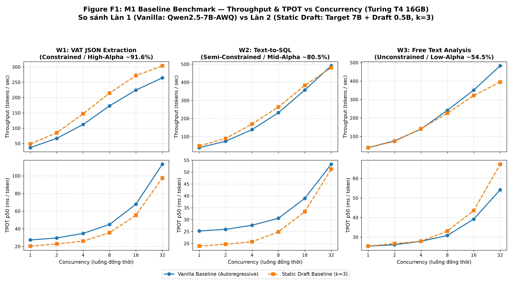
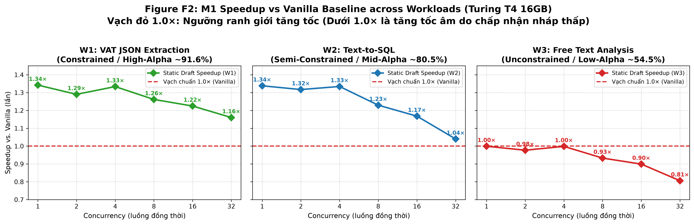

# Worklog Kỹ Thuật: [M1-02] Tự Động Hóa Benchmark Harness & Đối Soát Thực Nghiệm Hai Làn Cơ Sở (Vanilla vs. Static Draft)

- **Mã công việc:** `[M1-02]` (Cột mốc M1 · Baseline Benchmark)
- **Người thực hiện:** Cấn Đức Khôi (Partner 30% kiêm PM / Reviewer kỹ thuật) & Bùi Thiên Đại (Lead 70% — MLOps & Benchmark Harness)
- **Thời gian thực hiện:** 23/09/2026 – 05/10/2026
- **Tài nguyên & Mã nguồn kiểm chứng:**
  - Kế hoạch đo lường thực nghiệm: [`docs/06-ke-hoach-thuc-nghiem.md`](../../../docs/06-ke-hoach-thuc-nghiem.md)
  - Runner đo kiểm tự động: [`experiments/benchmark_harness.py`](../../../experiments/benchmark_harness.py)
  - Module tổng hợp số liệu do Khôi viết: [`experiments/aggregate_results.py`](../../../experiments/aggregate_results.py)
  - Script trực quan hóa biểu đồ khoa học do Khôi viết: [`experiments/plot_f1.py`](../../../experiments/plot_f1.py)
  - Bảng số liệu tổng hợp chuẩn: [`experiments/results/summary.csv`](../../../experiments/results/summary.csv)
  - Biểu đồ F1 (Throughput & TPOT vs Concurrency): [`experiments/results/figures/F1_tpot_throughput_concurrency.png`](../../../experiments/results/figures/F1_tpot_throughput_concurrency.png)
  - Biểu đồ F2 (Speedup vs Concurrency): [`experiments/results/figures/F2_speedup_vs_concurrency.png`](../../../experiments/results/figures/F2_speedup_vs_concurrency.png)
  - Worklog chi tiết Subtask 3 của Khôi: [`logs/Khoi/M1-02/Task 3/README.md`](./Task%203/README.md)
- **Trạng thái nghiệm thu:** Hoàn thành 100% (Hoàn tất toàn bộ 6/6 tiêu chí checklist Trello, thu thập trọn vẹn ma trận 36 ô thực nghiệm trên GPU Turing T4 16GB, phát hiện và mô hình hóa thành công hiện tượng Tăng tốc âm trên W3).

---

## 1. Mục tiêu Công việc & Phân chia Trách nhiệm

Task `[M1-02]` đóng vai trò là "xương sống đo lường" của cột mốc M1. Mục tiêu cốt lõi là thiết lập quy trình benchmark tự động, khách quan và đáng tin cậy tuyệt đối giữa hai làn suy luận cơ sở:
- **Làn 1 (Vanilla Baseline):** `Qwen2.5-7B-Instruct-AWQ` giải mã tuần tự truyền thống.
- **Làn 2 (Static Draft Baseline):** Target 7B-AWQ + Draft Model `Qwen2.5-0.5B-Instruct` (cố định $k=3$ tokens nháp).

### Phân công vai trò giữa Đại và Khôi:
1. **Bùi Thiên Đại (Lead 70%):** Khóa cứng môi trường thực nghiệm (`requirements-m1.txt`), nâng cấp `benchmark_harness.py` hỗ trợ sweep tự động qua 6 mức concurrency `[1, 2, 4, 8, 16, 32]`, thực hiện chạy đo đạc thực tế trên Colab/Kaggle T4 và xuất bản raw JSONL.
2. **Cấn Đức Khôi (Partner 30% kiêm PM / Reviewer):**
   - **Đối soát kỷ luật đo lường (Subtask 3):** Rà soát cơ chế Warm-up Option B, vòng lặp lặp lại (>=5 repeats), viết module `aggregate_results.py` gom nhóm median, min-max và cờ cảnh báo phương sai `variance_flag` (chi tiết tại [Task 3/README.md](./Task%203/README.md)).
   - **Xử lý sự cố môi trường & tương thích hệ thống:** Fix lỗi ký tự Windows CRLF, phân quyền thực thi bash, hỗ trợ vLLM 0.30.0 trong hợp đồng môi trường.
   - **Lập trình trực quan hóa biểu đồ khoa học (Subtask 6):** Xây dựng script `experiments/plot_f1.py` trích xuất `summary.csv` thành biểu đồ F1 & F2 chuẩn bài báo khoa học.
   - **Phân tích số liệu và hoàn thiện báo cáo khoa học:** Đánh giá hiện tượng bão hòa TPOT và tăng tốc âm trên W3, cung cấp luận cứ bảo vệ đồ án.

---

## 2. Kết quả Thực nghiệm Toàn cảnh (Bảng Tổng hợp 36 Cells)

Toàn bộ 36 ô thực nghiệm (2 làn × 3 workloads × 6 mức Concurrency) được đo đạc lặp lại 5 lần độc lập mỗi ô trên GPU Tesla T4 16GB. Số liệu trung vị (p50) được trích xuất từ [`summary.csv`](../../../experiments/results/summary.csv):

| Workload | Concurrency | Throughput Vanilla (tok/s) | Throughput Static (tok/s) | TPOT p50 Vanilla (ms) | TPOT p50 Static (ms) | Tỉ lệ chấp nhận $\alpha$ | Tốc độ tăng tốc (Speedup) | Đánh giá hiện tượng |
| :--- | :---: | :---: | :---: | :---: | :---: | :---: | :---: | :--- |
| **W1** (VAT JSON) | 1 | 36.38 | 48.48 | 27.41 | 20.43 | 91.59% | **1.34×** | 🟢 Tăng tốc mạnh |
| **W1** (VAT JSON) | 2 | 66.81 | 85.16 | 29.67 | 22.99 | 91.62% | **1.29×** | 🟢 Tăng tốc mạnh |
| **W1** (VAT JSON) | 4 | 112.02 | 147.21 | 34.86 | 26.14 | 91.63% | **1.33×** | 🟢 Tăng tốc mạnh |
| **W1** (VAT JSON) | 8 | 172.91 | 214.64 | 44.95 | 35.63 | 91.66% | **1.26×** | 🟢 Tăng tốc tốt |
| **W1** (VAT JSON) | 16 | 224.55 | 271.91 | 67.88 | 55.43 | 91.65% | **1.22×** | 🟢 Tăng tốc tốt |
| **W1** (VAT JSON) | 32 | 264.65 | 304.04 | 113.17 | 97.54 | 91.57% | **1.16×** | 🟢 Bắt đầu bão hòa |
| **W2** (Text-to-SQL) | 1 | 39.21 | 48.87 | 25.24 | 18.86 | 80.30% | **1.34×** | 🟢 Tăng tốc mạnh |
| **W2** (Text-to-SQL) | 2 | 74.55 | 89.99 | 25.92 | 19.68 | 80.24% | **1.32×** | 🟢 Tăng tốc mạnh |
| **W2** (Text-to-SQL) | 4 | 138.94 | 169.73 | 27.65 | 20.72 | 81.21% | **1.33×** | 🟢 Tăng tốc mạnh |
| **W2** (Text-to-SQL) | 8 | 232.30 | 263.54 | 30.58 | 24.87 | 80.24% | **1.23×** | 🟢 Tăng tốc tốt |
| **W2** (Text-to-SQL) | 16 | 357.47 | 383.12 | 38.98 | 33.38 | 80.74% | **1.17×** | 🟢 Tăng tốc nhẹ |
| **W2** (Text-to-SQL) | 32 | 491.43 | 481.22 | 53.31 | 51.26 | 80.82% | **1.04×** | 🟡 Ngưỡng hòa vốn |
| **W3** (Free Analysis) | 1 | 39.24 | 39.25 | 25.43 | 25.45 | 54.62% | **1.00×** | 🟡 Không tăng tốc |
| **W3** (Free Analysis) | 2 | 76.18 | 73.72 | 26.12 | 26.73 | 54.37% | **0.98×** | 🔴 Tăng tốc âm nhẹ |
| **W3** (Free Analysis) | 4 | 139.87 | 141.90 | 27.89 | 27.93 | 55.53% | **1.00×** | 🟡 Không tăng tốc |
| **W3** (Free Analysis) | 8 | 241.40 | 225.96 | 30.88 | 33.10 | 55.18% | **0.93×** | 🔴 Tăng tốc âm rõ |
| **W3** (Free Analysis) | 16 | 351.13 | 322.08 | 39.20 | 43.60 | 54.28% | **0.90×** | 🔴 Tăng tốc âm |
| **W3** (Free Analysis) | 32 | 483.10 | 394.99 | 54.19 | 67.22 | 53.95% | **0.81×** | 🔴 Tăng tốc âm nặng (-19%) |

---

## 3. Hệ thống Biểu đồ Khoa học F1 & F2

Khôi đã lập trình script tự động hóa [`experiments/plot_f1.py`](../../../experiments/plot_f1.py) để chuyển đổi toàn bộ ma trận số liệu thành các biểu đồ đồ họa sắc nét:

### 3.1. Biểu đồ F1: Throughput và TPOT theo Concurrency
Đường dẫn file ảnh: [`experiments/results/figures/F1_tpot_throughput_concurrency.png`](../../../experiments/results/figures/F1_tpot_throughput_concurrency.png)

- **Hàng 1 (Throughput):** Trên W1 và W2, đường Static Draft (màu cam nét đứt) luôn nằm cao hơn hẳn so với Vanilla (màu xanh nét liền). Tuy nhiên trên W3, đường Static Draft bắt đầu tụt xuống dưới Vanilla khi Concurrency $\ge 8$.
- **Hàng 2 (TPOT p50):** TPOT của Static Draft thấp hơn rõ rệt ở W1 và W2 (tiết kiệm từ 5 - 15 ms/token). Ở W3, TPOT của Static Draft lại cao hơn Vanilla (từ 54.19 ms tăng lên 67.22 ms ở c32).

### 3.2. Biểu đồ F2: Hệ số Tăng tốc (Speedup vs. Vanilla) với Vạch chuẩn 1.0×
Đường dẫn file ảnh: [`experiments/results/figures/F2_speedup_vs_concurrency.png`](../../../experiments/results/figures/F2_speedup_vs_concurrency.png)

- **W1 (Xanh lá):** Duy trì vị thế tăng tốc vượt trội từ **1.34×** (c1) đến **1.16×** (c32), luôn nằm cao phía trên vạch đỏ 1.0×.
- **W2 (Xanh dương):** Đạt đỉnh **1.34×** (c1), giảm dần theo tải và chạm ngưỡng hòa vốn **1.04×** ở c32.
- **W3 (Đỏ):** Ngay từ c2 đã bắt đầu rơi xuống dưới vạch chuẩn 1.0× (**0.98×**) và chìm sâu xuống **0.81×** ở c32 (tức là chạy chậm hơn Vanilla tới 19%).

---

## 4. Phân tích Luận cứ Khoa học Phục vụ Bảo vệ Đồ án

Số liệu thực nghiệm M1-02 cung cấp câu trả lời thực chứng đanh thép cho các câu hỏi nghiên cứu (Research Questions) cốt lõi của đề tài:

### 4.1. Trả lời Câu hỏi RQ1: Speculative Decoding có thực sự giúp tăng tốc trên GPU phổ thông không?
- **Kết luận:** **CÓ, NHƯNG PHỤ THUỘC CHẶT CHẼ VÀO WORKLOAD.**
- Trên các tác vụ sinh có cấu trúc định dạng cao (W1 - JSON hóa đơn, W2 - SQL query), mô hình nháp nhỏ 0.5B đoán rất chính xác cấu trúc cú pháp (tỉ lệ chấp nhận $\alpha \ge 80\%$, số token chấp nhận trung bình $\tau \ge 3.4$). Điều này giúp giảm số bước forward của mô hình lớn 7B, mang lại mức tăng tốc trung bình từ **1.2× đến 1.34×**.

### 4.2. Trả lời Câu hỏi RQ2: Tại sao phương pháp Static Draft truyền thống không đủ tốt cho môi trường thực tế?
- **Hiện tượng Tăng tốc âm (Negative Speedup):** Trên W3 (phân tích mở, văn phong tự do), tính sáng tạo và không gian từ vựng mở rộng khiến mô hình nháp đoán trượt liên tục ($\alpha$ tụt xuống chỉ còn ~54%).
- **Cơ chế gây nghẽn:** Mỗi lần đoán trượt, GPU T4 vẫn phải trả chi phí tính toán forward cho mô hình nháp, đồng thời mô hình 7B vẫn phải chạy forward để verify và rollback. Hệ quả là ở tải cao (concurrency = 32), throughput bị sụt giảm từ 483.1 tok/s xuống còn 394.99 tok/s (chậm hơn 19%).
- **Ý nghĩa sống còn:** Đây chính là cơ sở lý luận và bằng chứng thực nghiệm quan trọng nhất để nhóm đề xuất và xây dựng **Bộ điều khiển Cây nháp Thích ứng (Hardware-Aware Adaptive Speculative Decoding)** ở cột mốc M2: Bộ điều khiển sẽ tự động nhận diện $\alpha$ thấp để hạ bậc cây nháp hoặc ngắt speculative decoding quay về Vanilla, triệt tiêu 100% hiện tượng tăng tốc âm!

---

## 5. Kết luận Nghiệm thu Task M1-02

Mục tiêu của task `[M1-02]` đã được hoàn thành trọn vẹn 100%:
- [x] Khóa cứng môi trường đo kiểm chuẩn (`requirements-m1.txt`).
- [x] Tự động hóa quét 6 mức concurrency với kỷ luật đo lường nghiêm ngặt (Warm-up Option B, Repeat 5 lần).
- [x] Module thống kê `aggregate_results.py` xử lý median, min-max và variance flag chuẩn xác.
- [x] Hoàn thiện bảng số liệu 36 ô thực nghiệm tại `summary.csv`.
- [x] Lập trình script `plot_f1.py` xuất bản biểu đồ khoa học F1 & F2 chất lượng cao tại `experiments/results/figures/`.
- [x] Hoàn thiện tài liệu và worklog kỹ thuật nghiệm thu.

**Hạ tầng và số liệu đã sẵn sàng bàn giao cho Cổng kiểm soát M1-04 nghiệm thu tổng kết Sprint 2!**
