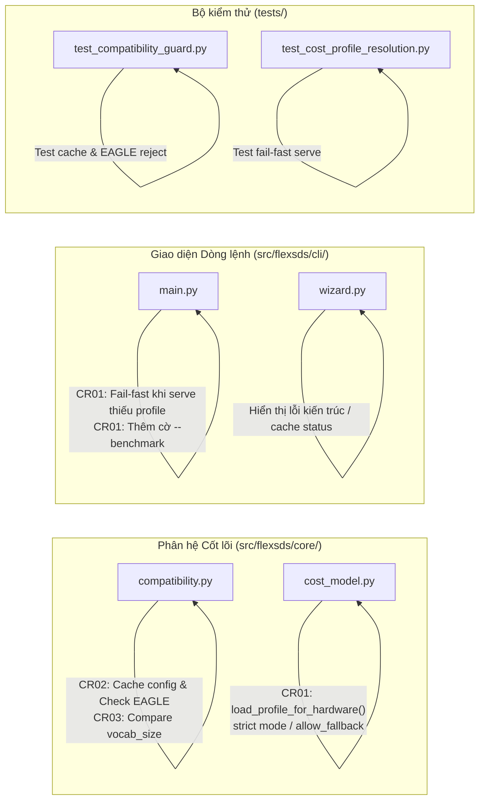

# Bản đặc tả kỹ thuật yêu cầu thay đổi (Change Request Specification)
## Mã định danh: CR01 -> CR03 (Phân hệ Phần cứng & Tương thích)

> **Dự án:** FlexSDS - Flexible Speculative Decoding Serving Engine for LLMs  
> **Nhóm thực hiện:** Cấn Đức Khôi & Bùi Đức Đại  
> **Đơn vị:** Nhóm đồ án D22 - Học viện Công nghệ Bưu chính Viễn thông (PTIT)  
> **Trạng thái:** Bản thảo kỹ thuật (Draft Specification)  
> **Áp dụng cho:** Phiên bản FlexSDS v0.2.0-alpha  

---

## 1. Tổng quan các yêu cầu thay đổi (Change Request Summary)

Tài liệu này đặc tả chi tiết 3 phiếu yêu cầu thay đổi (Change Request - CR) nhằm nâng cấp kiến trúc hệ thống phục vụ giải mã đầu cơ FlexSDS từ giai đoạn thử nghiệm sang chuẩn phục vụ thực tế:

| Mã phiếu | Yêu cầu liên quan | Phân hệ | Tên yêu cầu thay đổi | Mục tiêu cốt lõi |
| :---: | :---: | :---: | :--- | :--- |
| **CR01** | `REQ-HW-03` | Phần cứng | Đo đạc và hiệu chuẩn hồ sơ phần cứng độc lập | Tách rời chức năng benchmark; áp dụng cơ chế thất bại sớm (fail-fast) khi `serve` nếu chưa có hồ sơ GPU. |
| **CR02** | `REQ-CMP-01` | Tương thích | Kiểm tra tương thích qua metadata và bộ nhớ đệm | Tải và lưu cache `config.json`; bắt lỗi mất mạng minh bạch; khóa cứng phạm vi chỉ hỗ trợ đầu nháp EAGLE. |
| **CR03** | `REQ-CMP-02` | Tương thích | Phát hiện từ vựng dị thể tổng quát qua `vocab_size` | Đọc trực tiếp `vocab_size` từ cache cấu hình của 2 mô hình để tự động quyết định cờ `--use-heterogeneous-vocab`. |

---

## 2. Chi tiết yêu cầu thay đổi CR01 (`REQ-HW-03`)

### 2.1. Vấn đề hiện tại
Hiện tại, khi người dùng gọi lệnh `flexsds serve` trên một phần cứng chưa từng đo đạc, hệ thống tự động rơi vào hồ sơ an toàn dự phòng phân tích (Conservative Fallback Profile). Điều này dẫn đến sự thiếu tách bạch giữa việc đo đạc hiệu chuẩn phần cứng và tiến trình mở cổng phục vụ, tiềm ẩn nguy cơ hiệu năng không tối ưu nếu người dùng không biết GPU của mình chưa được benchmark.

### 2.2. Yêu cầu thiết kế mới
1. **Phân tách hoàn toàn hai vòng đời:**
   - **Vòng đời phục vụ (`flexsds serve`):** Chỉ làm nhiệm vụ kiểm tra và nạp hồ sơ có sẵn.
   - **Vòng đời đo đạc (`flexsds profile --benchmark`):** Độc lập đo đạc $c_t, c_d$ trên GPU hiện tại và xuất tệp hồ sơ JSON.
2. **Cơ chế thất bại sớm (Fail-fast) khi phục vụ:**
   - Khi chạy `flexsds serve`:
     + **Trường hợp 1 (Đã có hồ sơ):** Khớp với hồ sơ chuẩn tích hợp (`profile_sm89_l4.json`, `profile_sm75_t4.json`) hoặc hồ sơ cá nhân trong `~/.flexsds/profiles/` $\to$ nạp ngay lập tức (< 1ms) và khởi chạy máy chủ vLLM.
     + **Trường hợp 2 (Chưa có hồ sơ):** Từ chối khởi chạy máy chủ ngay lập tức (exit code 1), in thông báo lỗi màu đỏ kèm hướng dẫn chạy lệnh đo đạc:
       ```text
       ✖ [Lỗi phần cứng] Chưa có hồ sơ độ trễ cho GPU 'RTX 4090 (sm_89)'.
       Hệ thống từ chối phục vụ để tránh suy giảm tốc độ giải mã đầu cơ.
       Vui lòng chạy lệnh đo đạc hiệu chuẩn trước:
         flexsds profile --benchmark
       (Hoặc thêm cờ '--allow-fallback' nếu bạn muốn chạy thử nghiệm tạm thời).
       ```
3. **Lệnh đo đạc độc lập (`flexsds profile --benchmark`):**
   - Chạy các bước khởi động ấm (warm-up) và forward pass thử nghiệm đo độ trễ trung vị của mô hình mục tiêu $c_t(B)$ và đầu nháp $c_d(B)$ trên các batch size đại diện [1, 2, 4, 8].
   - Tự động xuất tệp hồ sơ chuẩn `~/.flexsds/profiles/profile_<sm_arch>_<slug>.json` thông qua hàm `save_hardware_profile()`.
   - Giải phóng sạch sẽ 100% VRAM trước khi kết thúc tiến trình.

---

## 3. Chi tiết yêu cầu thay đổi CR02 (`REQ-CMP-01`)

### 3.1. Vấn đề hiện tại
Hàm `check_compatibility()` hiện tại đang kiểm tra phương pháp đầu cơ dựa vào so khớp chuỗi tên (string regex: nếu tên chứa chữ `"eagle"` thì gán `"eagle3"`). Cách làm này thiếu tin cậy khi người dùng đổi tên mô hình hoặc lưu checkpoint trong thư mục riêng.

### 3.2. Yêu cầu thiết kế mới
1. **Quy trình nạp và quản lý bộ nhớ đệm cấu hình (Config Cache Lifecycle):**
   - Thư mục lưu cache cục bộ: `~/.flexsds/cache/models/<sanitized_model_id>/config.json`.
   - **Bước 1 (Kiểm tra cache):** Kiểm tra xem tệp `config.json` đã tồn tại trong thư mục cache cục bộ (hoặc cache của Hugging Face `~/.cache/huggingface/hub/`) chưa.
   - **Bước 2 (Tải từ Hub nếu chưa có):** Nếu chưa có cache, gửi yêu cầu HTTP GET đến `https://huggingface.co/<model_id>/raw/main/config.json`.
   - **Bước 3 (Ghi cache):** Tải về thành công thì lập tức ghi vào thư mục cache để các lần chạy sau không phải tải lại qua mạng.
   - **Bước 4 (Xử lý lỗi mạng):** Nếu không thể kết nối đến Hugging Face Hub (mất mạng) và trong cache cục bộ chưa có tệp `config.json`, hệ thống dừng tiến trình và báo lỗi minh bạch:
     ```text
     ✖ [Lỗi mạng] Không thể tải tệp metadata config.json cho mô hình '<model_id>'.
     Hệ thống không phát hiện kết nối Internet và không tìm thấy bản cache cục bộ.
     Vui lòng kiểm tra lại đường truyền mạng hoặc nạp mô hình từ đường dẫn ổ đĩa.
     ```
2. **Khóa cứng phạm vi hỗ trợ kiến trúc EAGLE:**
   - Đọc trường `architectures` hoặc `model_type` trong tệp `config.json` của mô hình nháp.
   - Nếu `architectures` chứa `EagleModel` hoặc `EagleForCausalLM` $\to$ xác định `draft_method = "eagle3"`.
   - **Nếu KHÔNG thuộc kiến trúc EAGLE** (ví dụ là mô hình tự hồi quy tiêu chuẩn `Qwen2ForCausalLM`, `LlamaForCausalLM`):
     Hệ thống từ chối phục vụ (gán `is_compatible = False`), in thông báo lỗi:
     ```text
     ✖ [Lỗi kiến trúc] Phiên bản FlexSDS hiện tại chỉ hỗ trợ kiến trúc đầu nháp EAGLE.
     Mô hình nháp '<draft_model>' thuộc kiến trúc '<arch>' không được hỗ trợ.
     Gợi ý: Vui lòng sử dụng đầu nháp EAGLE-3.1 tương ứng (ví dụ: duckhoi/qwen2.5-7b-eagle3.1-speculator).
     ```

---

## 4. Chi tiết yêu cầu thay đổi CR03 (`REQ-CMP-02`)

### 4.1. Vấn đề hiện tại
Quy trình phát hiện từ vựng dị thể hiện tại đang dựa trên quy tắc lọc họ tên mô hình (`"qwen"`, `"llama"`) và gán cứng cho cặp Qwen2.5-7B + EAGLE-3.1, chưa đọc trực tiếp thông số kích thước từ vựng thực tế của các mô hình tùy ý.

### 4.2. Yêu cầu thiết kế mới
1. **Đọc thuộc tính số nguyên `vocab_size` trực tiếp:**
   - Trích xuất trường `vocab_size` từ đối tượng metadata `config.json` đã được lưu cache của cả hai mô hình:
     - `target_vocab = target_config.get("vocab_size", 0)`
     - `draft_vocab = draft_config.get("vocab_size", 0)`
2. **Thuật toán kích hoạt cờ từ vựng dị thể (`use_heterogeneous_vocab`):**
   - **Điều kiện bật (`True`):**
     + `target_vocab != draft_vocab` (kích thước từ vựng lệch nhau).
     + Hoặc mô hình nháp là kiến trúc EAGLE (đầu nháp EAGLE luôn thu gọn từ vựng xuống top-16k để giảm kích thước ma trận `lm_head` từ 1.09 GB xuống còn 114 MB, giảm 89.5% bộ nhớ).
   - **Điều kiện tắt (`False`):**
     + `target_vocab == draft_vocab` và không phải kiến trúc EAGLE (hai mô hình dùng chung hoàn toàn tokenizer gốc).
3. **Cảnh báo khi ghép cặp khác họ mô hình (Cross-Family Warning):**
   - Nếu phát hiện hai mô hình khác họ kiến trúc gốc (ví dụ LLaMA ghép với Qwen):
     + Vẫn bật `use_heterogeneous_vocab = True` để tránh lỗi sập tensor shape trong vLLM.
     + Nhưng bổ sung cảnh báo màu vàng:
       `⚠ Cảnh báo: Mô hình mục tiêu và mô hình nháp thuộc hai họ kiến trúc khác nhau. Tỷ lệ chấp nhận token (alpha) có thể bị suy giảm nghiêm trọng do không gian ngữ nghĩa không đồng nhất.`

---

## 5. Danh mục các tệp mã nguồn cần chỉnh sửa



| Tệp mã nguồn | Nội dung cần chỉnh sửa theo Change Request |
| :--- | :--- |
| `src/flexsds/core/compatibility.py` | 1. Bổ sung hàm quản lý cache tệp `config.json` tại `~/.flexsds/cache/models/`.<br>2. Bắt lỗi không có internet khi chưa có cache.<br>3. Kiểm tra trường `architectures` của draft model, từ chối nếu không phải EAGLE.<br>4. Đọc trường `vocab_size` của 2 mô hình để bật/tắt `use_heterogeneous_vocab`. |
| `src/flexsds/core/cost_model.py` | 1. Bổ sung tham số `strict: bool = False` cho hàm `load_profile_for_hardware()`.<br>2. Nếu `strict=True` mà không có hồ sơ chuẩn/người dùng thì trả về `None` thay vì tự động fallback. |
| `src/flexsds/cli/main.py` | 1. Thêm cờ `--benchmark` cho lệnh `flexsds profile`.<br>2. Trong lệnh `flexsds serve`: gọi `load_profile_for_hardware(strict=True)`. Nếu chưa có hồ sơ và không có cờ `--allow-fallback` thì dừng tiến trình và in thông báo hướng dẫn. |
| `tests/test_compatibility_guard.py` | Bổ sung các ca kiểm thử: tải và lưu cache `config.json`, từ chối mô hình không phải EAGLE, nhận diện lệch `vocab_size`. |
| `tests/test_flexsds_baseline.py` | Cập nhật các mock test tương ứng đảm bảo toàn bộ bộ test đạt 100%. |

---

## 6. Tiêu chuẩn nghiệm thu (Acceptance Criteria)

- [ ] **AC-01 (CR01):** Chạy `flexsds serve` trên GPU chưa có hồ sơ (không có cờ `--allow-fallback`) phải dừng tiến trình với mã lỗi `1` và in hướng dẫn chạy lệnh `flexsds profile --benchmark`.
- [ ] **AC-02 (CR01):** Lệnh `flexsds profile --benchmark` chạy thành công, đo đạc độ trễ và lưu tệp `profile_<sm>_<slug>.json` vào thư mục `~/.flexsds/profiles/`.
- [ ] **AC-03 (CR02):** Lần đầu tiên kiểm tra mô hình, tệp `config.json` được tải về và lưu vào cache `~/.flexsds/cache/models/`. Lần thứ hai kiểm tra, hệ thống đọc trực tiếp từ cache mà không gửi thêm request mạng nào.
- [ ] **AC-04 (CR02):** Khi ngắt kết nối mạng và chưa có cache, hệ thống báo lỗi mất kết nối Internet rõ ràng, không bị crash traceback.
- [ ] **AC-05 (CR02):** Nếu người dùng chọn mô hình nháp không chứa kiến trúc EAGLE (ví dụ `Qwen/Qwen2.5-0.5B-Instruct`), hệ thống từ chối phục vụ và báo lỗi rõ ràng.
- [ ] **AC-06 (CR03):** Nếu `target_vocab != draft_vocab` hoặc là EAGLE head, cờ `use_heterogeneous_vocab` luôn tự động được gán bằng `True` trong báo cáo và cấu hình phục vụ.
- [ ] **AC-07 (Toàn vẹn):** 100% các bài kiểm thử unit test và integration test trong repo đều PASS.
