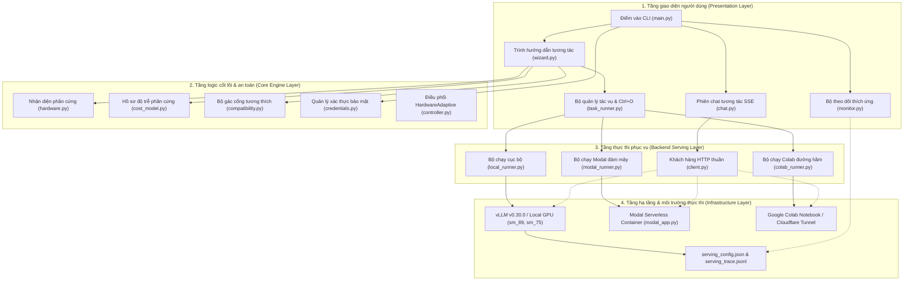
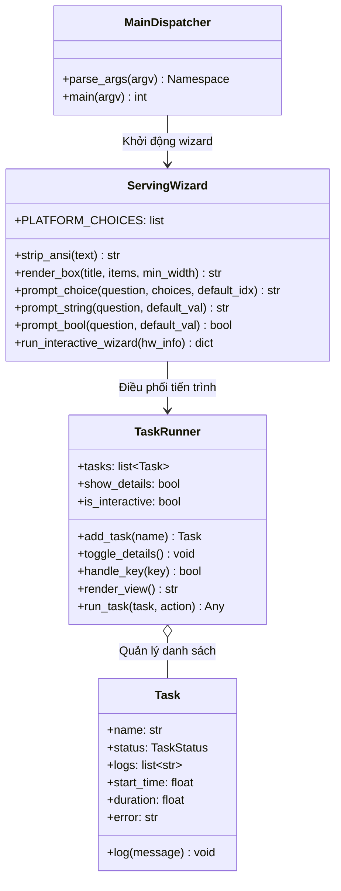
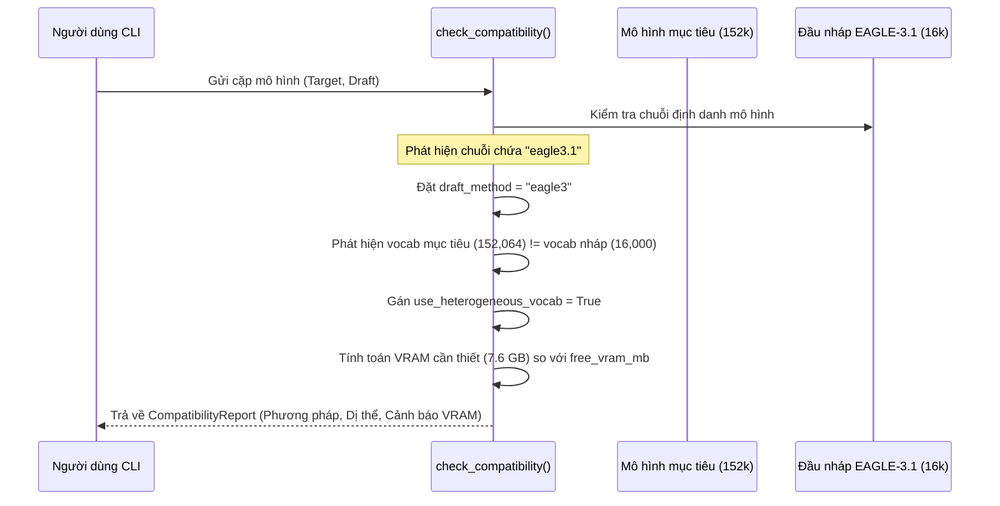
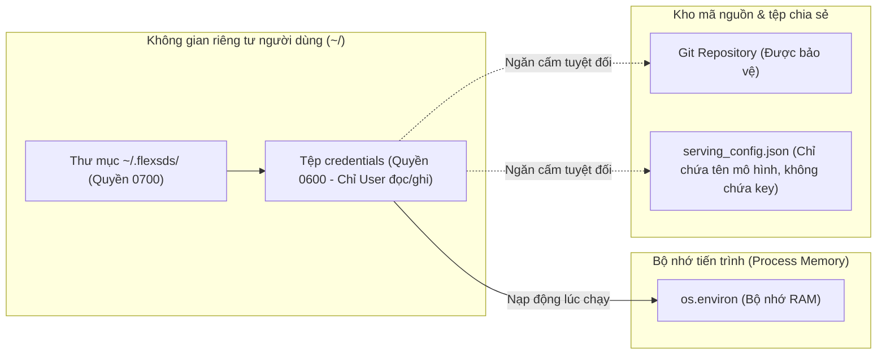
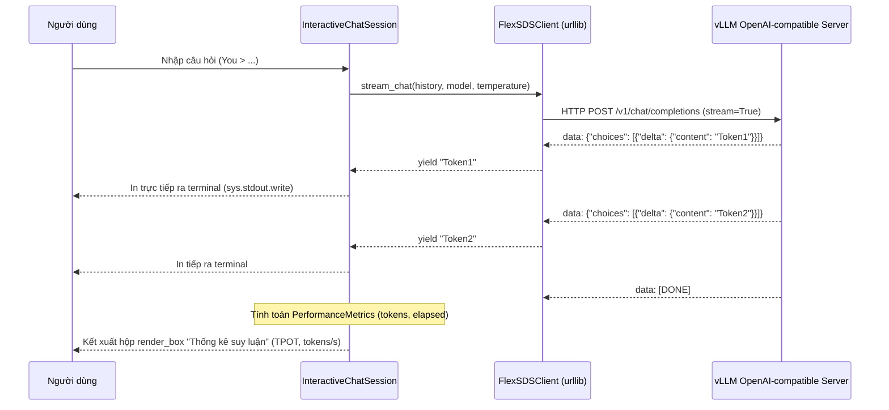

# Tài liệu thiết kế hệ thống FlexSDS CLI (System Design Document - SDD)

> **Tên đề tài:** Hệ thống phục vụ giải mã đầu cơ thích ứng FlexSDS cho mô hình ngôn ngữ lớn  
> **Phân hệ thiết kế:** Giao diện dòng lệnh tương tác và bộ điều phối phục vụ đa nền tảng (FlexSDS CLI & Serving Backend)  
> **Đơn vị thực hiện:** Nhóm đồ án D22 - Học viện Công nghệ Bưu chính Viễn thông (PTIT)  
> **Sinh viên thực hiện:** Cấn Đức Khôi, Bùi Đức Đại  
> **Giảng viên hướng dẫn:** [Điền tên giảng viên hướng dẫn]  
> **Phiên bản tài liệu:** v2.0 (Cập nhật kiến trúc HardwareAdaptive và bảo mật zero-leak)  
> **Ngày cập nhật:** 13/11/2026  

---

## Lịch sử sửa đổi tài liệu

| Phiên bản | Ngày | Tác giả | Nội dung thay đổi chính |
| :---: | :---: | :---: | :--- |
| `v1.0` | 05/11/2026 | Cấn Đức Khôi | Khởi tạo khung thiết kế giao diện dòng lệnh tương tác (Wizard UI) và phát hiện phần cứng. |
| `v1.5` | 10/11/2026 | Bùi Đức Đại | Bổ sung thiết kế bộ thực thi lineage bất đồng bộ (`LineageUniProcExecutor`) và mô hình chi phí GPU. |
| `v2.0` | 13/11/2026 | Cấn Đức Khôi | Chuẩn hóa kiến trúc HardwareAdaptive, thiết kế bảo mật credentials quyền `0600`, bộ quản lý tác vụ TaskRunner (phím tắt `Ctrl+O`), HTTP client SSE và bộ theo dõi telemetry. |

---

## Danh mục thuật ngữ và từ viết tắt

| Thuật ngữ / Viết tắt | Tên tiếng Anh đầy đủ | Giải thích ý nghĩa trong hệ thống |
| :--- | :--- | :--- |
| **CLI** | Command-Line Interface | Giao diện dòng lệnh giúp kỹ sư và người dùng tương tác với hệ thống. |
| **LLM** | Large Language Model | Mô hình ngôn ngữ lớn (ví dụ: Qwen2.5-7B-Instruct). |
| **SD** | Speculative Decoding | Phương pháp giải mã đầu cơ tăng tốc độ suy luận bằng mô hình nháp nhỏ. |
| **TPOT** | Time Per Output Token | Độ trễ trung bình để sinh ra một token mới (tính bằng mili-giây ms). |
| **VRAM** | Video Random Access Memory | Bộ nhớ truy cập ngẫu nhiên trên card đồ họa GPU. |
| **OOM** | Out Of Memory | Lỗi cạn kiệt bộ nhớ RAM hoặc VRAM khiến tiến trình bị dừng đột ngột. |
| **SSE** | Server-Sent Events | Giao thức truyền dữ liệu đơn hướng thời gian thực qua HTTP stream. |
| **AWQ** | Activation-aware Weight Quantization | Phương pháp lượng tử hóa 4-bit trọng số mô hình giúp tiết kiệm VRAM. |
| **SDD** | Software Design Document | Tài liệu đặc tả thiết kế kiến trúc và thành phần phần mềm. |
| **PTIT** | Posts and Telecommunications Institute of Technology | Học viện Công nghệ Bưu chính Viễn thông. |

---

## 1. Tổng quan hệ thống và mục tiêu thiết kế

### 1.1. Bối cảnh đề tài
Việc triển khai phục vụ (serving) các mô hình ngôn ngữ lớn (LLM) đòi hỏi tài nguyên tính toán GPU rất lớn và thường gặp nút thắt cổ chai về băng thông bộ nhớ (memory bandwidth bound) trong giai đoạn autoregressive decoding. Kỹ thuật giải mã đầu cơ (Speculative Decoding) giải quyết vấn đề này bằng cách kết hợp một mô hình nháp (draft model) nhỏ, nhanh hơn để đoán trước $K$ token, sau đó dùng mô hình mục tiêu (target model) kiểm tra song song trong một bước tính toán.

Tuy nhiên, việc thiết lập, cấu hình và giám sát các tham số đầu cơ trên nhiều nền tảng phần cứng khác nhau (máy trạm cục bộ, Google Colab GPU miễn phí, Modal Serverless GPU đám mây) là rào cản lớn đối với kỹ sư và người dùng cuối. Phân hệ **FlexSDS CLI & Serving Backend** được thiết kế nhằm mục đích tự động hóa toàn bộ quy trình này.

### 1.2. Mục tiêu thiết kế cốt lõi
1. **Tính tương thích và tối ưu hóa phần cứng (Hardware-Centric Adaptation):** Tự động nhận diện kiến trúc GPU (Ada Lovelace L4, Turing T4, Ampere A100) và áp dụng hồ sơ chi phí tính toán để điều phối số token đầu cơ $K$ tối ưu nhất.
2. **Hợp nhất đa nền tảng (Multi-Platform Abstraction):** Cung cấp một giao diện điều khiển dòng lệnh đồng nhất cho 3 môi trường: Local vLLM, Modal Cloud và Google Colab.
3. **Bảo mật tuyệt đối (Zero-Leak Security):** Quản lý khóa API, token đám mây tại vùng nhớ cách ly của người dùng (`~/.flexsds/credentials`, quyền POSIX `0600`), tuyệt đối không lưu vết vào kho mã nguồn hay file cấu hình chia sẻ.
4. **Trực quan hóa và trải nghiệm người dùng cao cấp (Terminal UX):** Thiết kế menu mũi tên TTY mượt mà, bộ quản lý tác vụ TaskRunner gọn gàng hỗ trợ phím tắt `Ctrl+O` mở rộng nhật ký, phiên chat stream token kèm hộp đo TPOT và bộ theo dõi telemetry thời gian thực.
5. **Độc lập và tự chủ (Zero Heavy Client Dependency):** Máy khách CLI không phụ thuộc vào các thư viện bên thứ ba cồng kềnh (`requests`, `openai`), sử dụng thuần thư viện chuẩn của Python (`urllib`, `socket`) để đảm bảo khởi động tức thì (< 0.2s).

---

## 2. Kiến trúc tổng thể hệ thống

Hệ thống FlexSDS được thiết kế theo mô hình kiến trúc phân lớp (Layered Architecture) gồm 4 tầng độc lập, đảm bảo nguyên lý trách nhiệm đơn lẻ (Single Responsibility Principle) và khả năng mở rộng trong tương lai.



---

## 3. Thiết kế chi tiết các phân hệ thành phần

### 3.1. Phân hệ giao diện tương tác dòng lệnh (CLI Presentation Subsystem)

#### 3.1.1. Sơ đồ lớp thành phần (Class Diagram)


#### 3.1.2. Cơ chế xử lý phím tắt và căn chỉnh viền
- **Xử lý phím mũi tên và phím tắt `Ctrl+O`:** Sử dụng chế độ raw/cbreak của `termios` và `tty` trên hệ điều hành Linux/macOS. Khi phát hiện mã byte `\x0f` (tương ứng `Ctrl+O`), hệ thống đảo biến cờ `show_details` và kết xuất khung nhật ký 8 dòng log mới nhất.
- **Thuật toán căn viền chống lệch ANSI:** Ký tự điều khiển màu sắc ANSI (ví dụ `\033[1;32m`) có độ dài chuỗi byte nhưng không chiếm không gian hiển thị trên màn hình. Hàm `strip_ansi()` sử dụng biểu thức chính quy `\033\[[0-9;]*m` để tính toán độ dài thực tế của chữ, đảm bảo hai cạnh viền dọc của `render_box` luôn thẳng hàng tuyệt đối.

---

### 3.2. Phân hệ lõi phần cứng và mô hình chi phí (Hardware & Cost Model Subsystem)

#### 3.2.1. Cấu trúc dữ liệu phần cứng (`HardwareInfo`)
```python
@dataclass
class HardwareInfo:
    device_name: str          # Tên thiết bị GPU (ví dụ: "NVIDIA L4")
    sm_architecture: str      # Kiến trúc vi xử lý (ví dụ: "sm_89", "sm_75", "cpu")
    total_vram_mb: float      # Tổng dung lượng VRAM tính theo MB
    free_vram_mb: float       # Dung lượng VRAM còn trống tính theo MB
    cuda_version: str         # Phiên bản CUDA runtime (ví dụ: "12.4")
    is_cuda_available: bool   # Cờ xác nhận card NVIDIA có khả dụng không
    device_count: int = 0     # Số lượng GPU phát hiện được trên máy
```

#### 3.2.2. Bảng ánh xạ hồ sơ độ trễ phần cứng
Hệ thống sử dụng bảng ánh xạ sau để nạp file cấu hình chi phí tính toán:

| Vi kiến trúc GPU | Dòng GPU tiêu biểu | Tệp hồ sơ độ trễ | Đặc tính lượng tử hóa AWQ |
| :---: | :---: | :---: | :---: |
| `sm_89` | NVIDIA L4 (Ada Lovelace, 24GB) | `profile_sm89_l4.json` | Native BF16, AWQ Marlin kernel |
| `sm_75` | NVIDIA T4 (Turing, 16GB) | `profile_sm75_t4.json` | FP16 fallback, standard AWQ |
| `sm_80` / `sm_90` | NVIDIA A100 / H100 | `profile_sm89_l4.json` (fallback) | FP16/BF16 tensor cores |
| Khác / `cpu` | Intel / AMD / Mac M-Series | `profile_sm89_l4.json` (an toàn) | CPU memory emulation |

---

### 3.3. Phân hệ gác cổng tương thích mô hình (Model Compatibility Guard Subsystem)

#### 3.3.1. Thuật toán phân tích từ vựng dị thể (Heterogeneous Vocab Detection)
Trong mô hình giải mã đầu cơ chuẩn, mô hình mục tiêu và mô hình nháp thường có cùng không gian từ vựng. Tuy nhiên, đầu nháp chuyên dụng EAGLE-3.1 (`duckhoi/qwen2.5-7b-eagle3.1-speculator`) được tinh chỉnh rút gọn kích thước từ vựng xuống 16,000 tokens (so với 152,064 tokens của Qwen2.5-7B) nhằm thu nhỏ kích thước ma trận `lm_head` từ 1.09 GB xuống còn 114 MB (giảm 89.5% bộ nhớ VRAM).



---

### 3.4. Phân hệ quản lý thông tin xác thực bảo mật (Credentials & Security Subsystem)

#### 3.4.1. Kiến trúc lưu trữ không rò rỉ (Zero-Leak Storage Architecture)


#### 3.4.2. Thuật toán che giấu khóa nhạy cảm (`mask_secret`)
$$\text{Masked}(S) = \begin{cases} 
\text{"*****"}, & \text{nếu } \text{len}(S) \le 8 \\
S[0:3] + \text{"****..."} + S[-4:], & \text{nếu } \text{len}(S) > 8 
\end{cases}$$

---

### 3.5. Phân hệ điều phối phục vụ đa nền tảng (Multi-Platform Serving Subsystem)

#### 3.5.1. Thiết kế bộ chạy cục bộ (Local Serving Runner)
- **Kiểm tra cổng TCP:** Dùng `socket.socket(AF_INET, SOCK_STREAM)` thực hiện thử nghiệm `bind(("", port))`. Nếu cổng bị chiếm dụng, hủy khởi chạy và xuất thông báo hướng dẫn.
- **Thực thi Lineage Executor:** Bổ sung cờ `--distributed-executor-backend src.server.lineage_executor.LineageUniProcExecutor` và cấu hình speculative JSON qua cờ `--speculative-config`.
- **Cơ chế chạy nền (Daemon Mode):** Thiết lập `preexec_fn=os.setsid` để tách nhóm tiến trình mới, ghi PID vào `.flexsds.pid` và chuyển toàn bộ đầu ra vào `flexsds_server.log`.
- **Dừng an toàn:** Gửi tín hiệu `SIGTERM` tới nhóm tiến trình bằng `os.killpg(pid, signal.SIGTERM)`, tránh để sót tiến trình con vLLM mồ côi chiếm VRAM.

#### 3.5.2. Thiết kế bộ chạy Modal Cloud (Modal Serverless Runner)
- **Cơ chế giữ container sống:** Trong file [modal_app.py](file:///home/duckhoi04/Documents/Repo/Do-an/do-an-ptit-d22/src/flexsds/server/modal_app.py), tiến trình vLLM được giám sát bằng vòng lặp `proc.wait()`. Container không thoát sau 0.1 giây mà giữ nguyên trạng thái sẵn sàng nhận truy vấn.
- **Bộ gác cổng dừng ứng dụng (`check_process_status`):** Thường xuyên thăm dò tiến trình con của Modal; nếu ứng dụng bị dừng hoặc kết thúc sớm, lập tức bắt mã lỗi và thông báo cho người dùng, ngăn chặn trạng thái treo terminal.
- **Hai chế độ hoạt động:**
  - *Chế độ Ephemeral Run:* `modal run src/flexsds/server/modal_app.py --gpu L4` (chạy phiên tương tác theo nhu cầu).
  - *Chế độ Persistent Deploy:* `modal deploy src/flexsds/server/modal_app.py --gpu L4` (triển khai máy chủ web vĩnh viễn 24/7).

#### 3.5.3. Thiết kế bộ chạy Google Colab (Colab Serving Runner)
- **Sổ tay tối ưu:** Tệp [notebooks/flexsds_colab_server.ipynb](file:///home/duckhoi04/Documents/Repo/Do-an/do-an-ptit-d22/notebooks/flexsds_colab_server.ipynb) loại bỏ toàn bộ token PAT lưu cứng, sử dụng lệnh cài đặt có cờ `-q` để giữ cell sạch sẽ.
- **Thăm dò sức khỏe đường hầm (`verify_tunnel_health`):** Gửi yêu cầu HTTP GET thăm dò endpoint Cloudflare Tunnel với thời gian chờ 5.0 giây. Bắt lỗi `URLError` khi mô hình đang nạp checkpoint và xuất cảnh báo nhẹ nhàng.

---

### 3.6. Phân hệ máy khách trò chuyện tương tác (Interactive Chat Client Subsystem)

#### 3.6.1. Quy trình xử lý luồng Server-Sent Events (SSE)


#### 3.6.2. Công thức đo lường hiệu năng suy luận
$$\text{Tokens Per Second (tokens/s)} = \frac{N_{\text{tokens}}}{\Delta t}$$
$$\text{Time Per Output Token (TPOT in ms)} = \frac{\Delta t \times 1000}{N_{\text{tokens}}}$$

Trong đó $N_{\text{tokens}}$ là tổng số token mô hình sinh ra trong lượt, $\Delta t$ là thời gian xử lý đo bằng `time.perf_counter()`.

---

### 3.7. Phân hệ theo dõi thích ứng thời gian thực (Live Telemetry Monitor Subsystem)

#### 3.7.1. Thuật toán đọc tail con trỏ tệp không gây tải I/O
```python
def read_new_records(self) -> List[Dict[str, Any]]:
    if not os.path.exists(self.trace_path):
        return []
    with open(self.trace_path, "r", encoding="utf-8") as f:
        f.seek(self._file_pos)      # Di chuyển con trỏ tới vị trí đọc trước đó
        lines = f.readlines()       # Chỉ đọc những byte mới được ghi thêm
        self._file_pos = f.tell()   # Cập nhật mốc vị trí mới
    # Phân tích cú pháp JSON từng dòng, bỏ qua dòng ghi dở
    ...
```

---

## 4. Thiết kế dữ liệu và cấu trúc tệp lưu trữ

### 4.1. Cấu trúc tệp cấu hình phục vụ: `serving_config.json`
Tệp này được sinh ra tự động sau khi hoàn tất trình hướng dẫn wizard hoặc thông qua các cờ CLI:
```json
{
  "flexsds_version": "0.2.0-alpha",
  "action": "serve",
  "backend": "modal",
  "target_model": "Qwen/Qwen2.5-7B-Instruct-AWQ",
  "draft_model": "duckhoi/qwen2.5-7b-eagle3.1-speculator",
  "draft_method": "eagle3",
  "use_heterogeneous_vocab": true,
  "enable_adaptive": true,
  "profile_applied": "profile_sm89_l4.json",
  "target_gpu": "L4",
  "colab_tunnel_url": "",
  "modal_deploy": false,
  "hardware": {
    "device_name": "NVIDIA L4",
    "sm_architecture": "sm_89",
    "free_vram_mb": 22450.0
  }
}
```

### 4.2. Cấu trúc tệp thông tin xác thực bí mật: `~/.flexsds/credentials`
Tệp nằm ngoài kho mã nguồn tại thư mục người dùng, được bảo vệ bằng quyền POSIX `0600`:
```json
{
  "modal": {
    "MODAL_TOKEN_ID": "ak-test-token-id-12345",
    "MODAL_TOKEN_SECRET": "as-test-token-secret-67890"
  },
  "huggingface": {
    "HF_TOKEN": "hf_secret_token_abcdef123456"
  }
}
```

### 4.3. Định dạng bản ghi nhật ký thích ứng: `telemetry/serving_trace.jsonl`
Mỗi dòng là một đối tượng JSON ghi nhận chi tiết từng bước sinh token:
```json
{"step": 1, "lane": "adaptive", "executed_draft_token_count": 4, "accepted_draft_token_count": 3, "alpha_ema": 0.78, "source_batch_scalar_k": 4}
{"step": 2, "lane": "adaptive", "executed_draft_token_count": 4, "accepted_draft_token_count": 4, "alpha_ema": 0.82, "source_batch_scalar_k": 5}
```

---

## 5. Thiết kế xử lý sự cố và các yêu cầu phi chức năng

### 5.1. Bảng ma trận xử lý ngoại lệ và lỗi hệ thống

| Tình huống sự cố | Phân hệ phát hiện | Hành vi xử lý của hệ thống | Mã thoát / Thông báo |
| :--- | :--- | :--- | :---: |
| **Cổng mạng bị chiếm dụng** | `LocalServingRunner` | Dùng socket thăm dò trước; từ chối gọi vLLM; in hướng dẫn đổi cổng hoặc dừng server cũ. | `Code 0` kèm thông báo đỏ |
| **Thiếu token Modal** | `ModalServingRunner` | `check_credentials()` trả về False; chặn khởi chạy; hướng dẫn `flexsds auth login`. | `None` kèm gợi ý auth |
| **Container Modal dừng đột ngột** | `ModalServingRunner` | `check_process_status()` bắt mã thoát khác 0; in thông báo ứng dụng đã tắt, ngăn treo CLI. | `Exit code != 0` |
| **Đường hầm Colab chưa mở** | `ColabServingRunner` | Bắt `URLError` trong timeout 5s; thông báo mô hình đang nạp weights, không crash. | `Return False` |
| **Mất kết nối máy chủ khi chat** | `FlexSDSClient` | Bắt `urllib.error.URLError`; in thông báo mất kết nối; hướng dẫn kiểm tra `flexsds serve`. | `EndpointUnreachableError` |
| **Người dùng nhấn Ctrl+C khi stream** | `InteractiveChatSession` | Bắt `KeyboardInterrupt`; in thông báo hủy lượt trả lời; duy trì phiên chat cho câu tiếp theo. | Giữ nguyên phiên |
| **Tệp trace telemetry chưa có** | `TelemetryMonitor` | Kiểm tra `os.path.exists()`; in thông báo đang chờ máy chủ tạo tệp, không ném lỗi. | Chờ đợi êm dịu |
| **Dòng JSON bị ghi dở** | `TelemetryMonitor` | Khối `try ... except json.JSONDecodeError` tự động bỏ qua dòng lỗi, đọc dòng tiếp theo. | Không ngắt luồng |

---

## 6. Phần dành cho sinh viên hoàn thiện báo cáo [CẦN ĐIỀN]

> *Gợi ý cho nhóm đồ án khi đưa vào cuốn báo cáo thuyết minh tốt nghiệp:*

### 6.1. Đánh giá thực nghiệm hiệu năng suy luận [ĐIỀN VÀO ĐÂY]
- **Bảng so sánh tốc độ sinh token (Tokens/s):**
  - Chế độ cơ sở (Vanilla vLLM không đầu cơ): `[Điền giá trị tok/s]`
  - Chế độ đầu cơ tĩnh (Static $K=3$ hoặc $K=4$): `[Điền giá trị tok/s]`
  - Chế độ đầu cơ thích ứng FlexSDS HardwareAdaptive: `[Điền giá trị tok/s]`
  - Mức độ tăng tốc đạt được (Speedup ratio): `[Điền tỷ lệ tăng tốc, ví dụ 1.6x - 2.1x]`
- **Độ trễ trung bình mỗi token (TPOT ms):**
  - Vanilla: `[Điền giá trị ms]`
  - FlexSDS: `[Điền giá trị ms]`

### 6.2. Ảnh chụp màn hình minh họa giao diện thực tế [CHÈN HÌNH ẢNH]
1. *Hình 3.1:* Giao diện logo PTIT và trình hướng dẫn cấu hình từng bước (Interactive Serving Wizard).
2. *Hình 3.2:* Giao diện TaskRunner thu gọn và hiệu ứng mở rộng nhật ký bằng phím tắt `Ctrl+O`.
3. *Hình 3.3:* Phiên trò chuyện trực tiếp qua terminal kèm hộp đo đạc thống kê hiệu năng suy luận.
4. *Hình 3.4:* Dòng trạng thái bộ theo dõi thích ứng thời gian thực (Live Telemetry Monitor).

---

## 7. Kết luận tài liệu thiết kế

Bản thiết kế hệ thống **FlexSDS CLI & Multi-Platform Serving Backend** đã hoàn thiện đầy đủ các khía cạnh từ kiến trúc phân lớp, thiết kế lớp chi tiết, quy trình luồng xử lý, đặc tả tệp lưu trữ đến cơ chế xử lý sự cố an toàn. Kiến trúc này giải quyết triệt để vấn đề thích ứng phần cứng, bảo vệ an toàn thông tin định danh và mang lại trải nghiệm dòng lệnh chuyên nghiệp cho người dùng.
