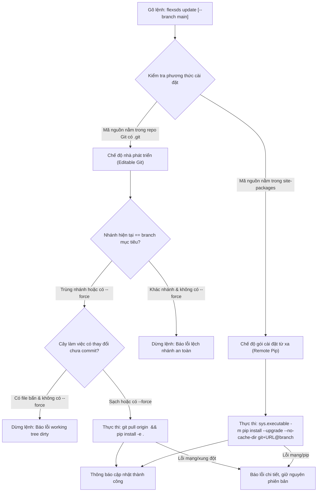

# Đặc tả kỹ thuật hỗ trợ cài đặt từ xa qua pip và cơ chế tự cập nhật phiên bản cho FlexSDS CLI

> **Tài liệu:** `spec.md`  
> **Mã định danh tác vụ:** `M5-03-PIP-INSTALL-UPDATE`  
> **Dự án:** Hoàn thiện trải nghiệm phân phối gói phần mềm và cơ chế tự cập nhật phiên bản cho FlexSDS  
> **Thành viên phụ trách:** Cấn Đức Khôi (Lead), Bùi Đức Đại (Reviewer)  
> **Vị trí lưu trữ:** `logs/Khoi/spec&plan/pipinstall&update/spec.md`  
> **Ngày lập:** 13/11/2026  
> **Trạng thái:** Bản phê duyệt thiết kế chính thức (Ghim nhánh phát hành `main` và bảo toàn cấu trúc hiện tại)  

---

## 1. Mục đích và bối cảnh kỹ thuật (Intent and why)

Sau khi hoàn thiện giao diện dòng lệnh tương tác (Interactive Wizard) và các bộ gác cổng an toàn (Pre-flight Guard, OOM Guard, Credentials Manager), FlexSDS đã sẵn sàng phục vụ thực tế trên nhiều hạ tầng. Tuy nhiên, khi chuyển giao đồ án cho người dùng thử nghiệm, sinh viên hoặc giảng viên chấm đồ án trên các máy tính khác, hệ thống gặp phải rào cản phân phối:

1. **Rào cản thiết lập môi trường truyền thống (Friction of clone and setup):**
   - Hiện tại, người dùng trên máy mới bắt buộc phải cài đặt Git, gõ lệnh `git clone`, chuyển thư mục, tạo môi trường ảo rồi chạy `pip install -e .`.
   - Đối với người dùng chỉ muốn thử nghiệm nhanh hoặc điều khiển phục vụ qua đám mây (Modal Cloud / Google Colab), quy trình này quá cồng kềnh. Người dùng mong muốn chỉ cần một lệnh cài đặt duy nhất từ nhánh ổn định `main`:
     ```bash
     pip install git+https://github.com/theflyingkhui04/do-an-ptit-d22.git@main
     ```
2. **Lỗi đóng gói và lỗi đường dẫn khi cài qua pip vào `site-packages`:**
   - Khi cài đặt từ xa qua Git URL hoặc PyPI, mã nguồn được đặt trong thư mục hệ thống `site-packages` thay vì thư mục làm việc Git.
   - `pyproject.toml` hiện tại chỉ đóng gói `flexsds*`, bỏ rơi các module máy chủ `src/server` và bộ lập lịch thích ứng.
   - Tệp [`local_runner.py`](file:///home/duckhoi04/Documents/Repo/Do-an/do-an-ptit-d22/src/flexsds/server/local_runner.py) và [`modal_app.py`](file:///home/duckhoi04/Documents/Repo/Do-an/do-an-ptit-d22/src/flexsds/server/modal_app.py) đang sử dụng chuỗi namespace cố định `src.server` và định vị đường dẫn tệp gốc bằng `Path(__file__).resolve().parents[3]`, dẫn tới lỗi văng tiến trình (`ModuleNotFoundError`, `FileNotFoundError`).
3. **Phụ thuộc vào mã nguồn đo kiểm thực nghiệm (`experiments/`):**
   - Bộ lập lịch `adaptive_scheduler.py` có import `protocol_b_boundary_observer` từ thư mục `experiments/`. Đây là công cụ đo kiểm nội bộ của nhóm nghiên cứu cho mốc M2-03, hoàn toàn không phục vụ sản phẩm suy luận thực tế. Cần bọc cơ chế dự phòng an toàn (no-op stub) để không buộc người dùng phổ thông phải cài đặt thư mục `experiments`.
4. **Nhu cầu đồng bộ và cập nhật phiên bản tự động (`flexsds update`):**
   - Nhánh `main` đóng vai trò là nhánh phát hành chính thức (ổn định). Mỗi khi có đợt cập nhật đã kiểm thử kỹ lưỡng từ nhánh `develop` merge vào `main`, người dùng trên máy khác chỉ cần gõ `flexsds update` là tự động kéo phiên bản mới nhất về máy.

---

## 2. Mục tiêu, phi mục tiêu và phản mục tiêu (Goals, non-goals, anti-goals)

### 2.1. Mục tiêu (Goals)
1. **Phân phối trọn vẹn qua pip từ nhánh `main`:**
   - Cho phép người dùng đứng ở bất kỳ thư mục nào trên máy khác chạy `pip install git+https://github.com/theflyingkhui04/do-an-ptit-d22.git@main` thành công 100%.
   - Lệnh `flexsds` có sẵn trong biến môi trường `PATH`, hoạt động trơn tru tất cả các lệnh: `detect`, `profile`, `auth`, `chat`, `serve` (cả backend Modal và Local).
2. **Chuẩn hóa đóng gói đa package trong `pyproject.toml`:**
   - Bao hàm đầy đủ các package phụ trợ `server`, `proposer`, `pipeline` trong cấu hình `setuptools`.
   - Đóng gói đầy đủ các tệp tài nguyên JSON (hồ sơ GPU, biểu mẫu kiểm tra, manifest) thông qua `package-data`.
3. **Triệt tiêu các đường dẫn cứng và giả định về thư mục Git gốc:**
   - Thay thế việc truy xuất `parents[3]` bằng cách xác định đường dẫn động bên trong package (`Path(__file__).resolve().parent.parent`).
   - Sửa chuỗi truyền cho vLLM engine để nạp đúng lớp `AdaptiveAsyncScheduler` dù chạy ở môi trường phát triển hay cài đặt trong `site-packages`.
4. **Hiện thực hóa lệnh tự cập nhật `flexsds update`:**
   - Xây dựng module `updater.py` và đăng ký subcommand `update` vào CLI.
   - Mặc định cập nhật từ nhánh `main` (`--branch main`).
   - Tự động nhận diện phương thức cài đặt hiện tại (cài đặt editable trong repo Git hay cài đặt gói pip) để áp dụng lệnh cập nhật phù hợp.
   - Có cơ chế bảo vệ an toàn: cảnh báo nếu đang đứng ở nhánh Git khác hoặc có thay đổi chưa commit.

### 2.2. Phi mục tiêu (Non-goals)
- Không xuất bản ngay lập tức lên kho PyPI công khai (chỉ chuẩn bị sẵn cấu trúc sẵn sàng, trước mắt tập trung phân phối qua GitHub URL nhánh `main`).
- Không tự động cập nhật các driver phần cứng hệ thống (NVIDIA driver, CUDA toolkit).

### 2.3. Phản mục tiêu (Anti-goals)
- Tuyệt đối không xóa hoặc ghi đè thư mục cấu hình và khóa bí mật của người dùng tại `~/.flexsds/` trong quá trình cập nhật.
- Không làm gián đoạn hoặc xáo trộn đường dẫn các bài kiểm thử tự động (`pytest tests/`) và kịch bản thực nghiệm hiện có trong kho mã nguồn.
- Không tự ý ghi đè mã nguồn nếu người dùng đang đứng ở nhánh làm việc khác trên repo Git cục bộ.

---

## 3. Ràng buộc kỹ thuật (Constraints)

1. **Ràng buộc tương thích vLLM v0.30.0:** Tham số `--scheduler-cls` và `--distributed-executor-backend` nhận đường dẫn chuỗi Python importable. Khi vLLM khởi động tiến trình con worker, module đó bắt buộc phải import được từ Python path hiện hành.
2. **Ràng buộc phân quyền hệ điều hành:** Lệnh `flexsds update` phải gọi chính xác trình thông dịch `sys.executable` của môi trường ảo (virtualenv/conda) đang kích hoạt để tránh ghi nhầm vào Python hệ thống toàn cục.
3. **Ràng buộc nền tảng Modal Cloud:** Ứng dụng `modal_app.py` khi đóng gói Docker image cần tìm thấy tệp cấu hình nguồn mà không bị phụ thuộc vào cây thư mục Git cấp cao.

---

## 4. Các phương án thiết kế và quyết định lựa chọn (Approaches)

### 4.1. Đánh giá phương án đóng gói mã nguồn
* **Lựa chọn:** Áp dụng **hướng tiếp cận 1** (giữ nguyên cấu trúc thư mục, đóng gói đa package trong `pyproject.toml`). Bổ sung `server*`, `proposer*`, `pipeline*` vào danh sách `include` của `pyproject.toml`.
* **Giải quyết phụ thuộc nội bộ giữa các module:** Áp dụng cơ chế import kép (dual import fallback):
  ```python
  try:
      from server.budget_planner import AdaptiveBudgetPlanner
  except ImportError:
      from src.server.budget_planner import AdaptiveBudgetPlanner
  ```
  Nhờ đó, mã nguồn hoạt động trơn tru trong cả 2 trường hợp: chạy từ thư mục gốc của repo Git (khi `src` nằm trong đường dẫn tìm kiếm) và chạy sau khi cài đặt qua pip vào `site-packages`.

### 4.2. Xử lý module đo kiểm `experiments`
* Phân tích vai trò: Module `protocol_b_boundary_observer` chỉ là công cụ thu thập số liệu nghiên cứu chuyên sâu cho mốc thực nghiệm M2-03 (được điều khiển qua các biến môi trường `M203_P177_*`). Sản phẩm phục vụ thương mại FlexSDS hoàn toàn không sử dụng dữ liệu này mà sử dụng kênh telemetry riêng (`telemetry/serving_trace.jsonl`).
* Giải pháp: Trong `src/server/adaptive_scheduler.py`, bọc import bằng `try...except ImportError`. Nếu không tìm thấy module `experiments`, gán các hàm dummy không làm gì (no-op stub):
  ```python
  try:
      from experiments.protocol_b_boundary_observer import observe as _pb279_observe
      from experiments.protocol_b_boundary_observer import control_producer as _pb177_control
  except ImportError:
      _pb279_observe = lambda *args, **kwargs: None
      _pb177_control = lambda *args, **kwargs: None
  ```
  Giải pháp này bảo đảm vLLM phục vụ với đầy đủ tính năng thích ứng mà không bắt buộc phải cài đặt thư mục `experiments`.

---

## 5. Đặc tả chi tiết phân hệ (Detailed specifications)

### 5.1. Phân hệ đóng gói package ([pyproject.toml](file:///home/duckhoi04/Documents/Repo/Do-an/do-an-ptit-d22/pyproject.toml))

1. **Mở rộng phạm vi tìm kiếm package:**
   ```toml
   [tool.setuptools.packages.find]
   where = ["src"]
   include = ["flexsds*", "server*", "proposer*", "pipeline*"]
   ```
2. **Khai báo tài nguyên đi kèm package (Package data):**
   Đặt bản sao tệp `scalar_vllm_source_manifest.json` vào thư mục `src/flexsds/assets/scalar_vllm_source_manifest.json` (song song với bản tại `experiments/` phục vụ test cũ).
   ```toml
   [tool.setuptools.package-data]
   flexsds = ["profiles/*.json", "assets/*", "assets/*.json"]
   ```

### 5.2. Chuẩn hóa đường dẫn nạp tài nguyên động

#### A. Xử lý trong [modal_app.py](file:///home/duckhoi04/Documents/Repo/Do-an/do-an-ptit-d22/src/flexsds/server/modal_app.py)
Cơ chế nhận diện đường dẫn 2 tầng (Hybrid resolver):
1. **Tầng 1 (Ưu tiên package data):** Tìm kiếm manifest tại `Path(__file__).resolve().parent.parent / "assets" / "scalar_vllm_source_manifest.json"`.
2. **Tầng 2 (Dự phòng thư mục Git):** Nếu không thấy, lùi về kiểm tra tại `PROJECT_ROOT / "experiments" / "scalar_vllm_source_manifest.json"`.
3. Khi thêm thư mục mã nguồn vào image Modal (`image.add_local_dir`):
   - Mount đồng nhất các thư mục package đã nạp (`flexsds`, `server`, `proposer`) vào `/root/project/` trong container và thiết lập `PYTHONPATH="/root/project"`.

#### B. Xử lý trong [local_runner.py](file:///home/duckhoi04/Documents/Repo/Do-an/do-an-ptit-d22/src/flexsds/server/local_runner.py)
Cập nhật chuỗi cờ gọi vLLM:
- Truyền tham số: `--scheduler-cls server.adaptive_scheduler.AdaptiveAsyncScheduler` và `--distributed-executor-backend server.lineage_executor.LineageUniProcExecutor`.
- Thiết lập biến môi trường `FLEXSDS_MANIFEST_PATH` trỏ tới tệp manifest hợp lệ trong package assets để `lineage_executor.py` và `lineage_startup.py` đọc trực tiếp mà không cần lùi cấp thư mục.

---

### 5.3. Phân hệ tự cập nhật phiên bản (`flexsds update`)

#### A. Module thực thi: `src/flexsds/cli/updater.py`
Xây dựng hàm `run_self_update(branch: str = "main", dry_run: bool = False, force: bool = False)` với quy trình logic:



#### B. Quy tắc thực thi an toàn của lệnh update:
1. **Ghim nhánh mặc định là `main`:**
   - URL cập nhật mặc định: `git+https://github.com/theflyingkhui04/do-an-ptit-d22.git@main`.
   - Khi nào có bản phát hành mới trên `develop` được merge vào `main`, lệnh `flexsds update` sẽ kéo bản phát hành chính thức này.
2. **Nhận diện chế độ chính xác:**
   - Kiểm tra đường dẫn cài đặt của module `flexsds` (`Path(__file__).resolve()`). Nếu tìm thấy thư mục `.git` ở các cấp thư mục cha của package, xác định là chế độ Git. Ngược lại, xác định là chế độ Pip trong `site-packages`.
3. **Bảo vệ nhánh và cây làm việc:**
   - Trong chế độ Git, nếu nhánh hiện tại khác nhánh cần cập nhật (ví dụ đang ở `develop` hoặc feature branch mà chạy update nhánh `main`), hệ thống từ chối pull trừ khi có cờ `--force`.
   - Nếu có thay đổi chưa commit (`git status --porcelain` khác rỗng), hệ thống cảnh báo để tránh ghi đè mã nguồn đang code.
4. **Luôn sử dụng `sys.executable`:** Tuyệt đối không gọi lệnh trần `pip`, mà gọi qua `[sys.executable, "-m", "pip", ...]`. Điều này bảo đảm cập nhật đúng môi trường ảo hiện hành mà người dùng đang kích hoạt.
5. **Cờ `--no-cache-dir`:** Đảm bảo pip không tái sử dụng wheel cũ trong bộ đệm mà luôn kéo mã nguồn mới nhất từ commit đầu nhánh của GitHub.

#### C. Đăng ký tham số trong [main.py](file:///home/duckhoi04/Documents/Repo/Do-an/do-an-ptit-d22/src/flexsds/cli/main.py):
- Subcommand `update` với các cờ:
  + `--branch <tên_nhánh>`: Chọn nhánh Git cần cập nhật (mặc định: `main`).
  + `--dry-run`: Xem trước lệnh thực thi mà không ghi đè gói.
  + `--force`: Cho phép cập nhật ngay cả khi lệch nhánh hoặc có cảnh báo trạng thái cây làm việc.

---

## 6. Kế hoạch kiểm thử và tiêu chí nghiệm thu (Acceptance criteria)

### 6.1. Tiêu chí nghiệm thu (DoD - Definition of Done)
1. **Cài đặt thành công trên môi trường trắng (Clean virtualenv):**
   - Tạo môi trường ảo hoàn toàn mới ngoài cây thư mục của dự án:
     ```bash
     python3 -m venv /tmp/test_flexsds_env
     source /tmp/test_flexsds_env/bin/activate
     pip install git+https://github.com/theflyingkhui04/do-an-ptit-d22.git@main
     ```
   - Lệnh `flexsds --version` hiển thị đúng phiên bản.
   - Lệnh `flexsds detect` quét phần cứng bình thường.
   - Lệnh `flexsds serve --backend local --dry-run` xuất đúng câu lệnh vLLM mà không ném lỗi import.
2. **Cơ chế cập nhật tự động:**
   - Chạy `flexsds update --dry-run` hiển thị chính xác lệnh pip nâng cấp trỏ vào nhánh `main`.
   - Chạy `flexsds update --branch main` thực thi thành công và cập nhật môi trường.
3. **Độ an toàn thông tin:**
   - Kiểm tra tệp `~/.flexsds/credentials` vẫn nguyên vẹn phân quyền `0600` sau khi chạy `flexsds update`.

### 6.2. Kiểm thử tự động (Unit and integration tests)
- Viết tệp kiểm thử mới: `tests/test_cli_update_command.py`:
  + `test_update_command_dry_run()`: Kiểm tra đầu ra lệnh mô phỏng mặc định với nhánh `main`.
  + `test_update_detects_git_mode_vs_pip_mode()`: Mocking kiểm tra phân nhánh xử lý giữa repo Git và `site-packages`.
  + `test_update_branch_mismatch_guard()`: Kiểm tra cơ chế chặn an toàn khi nhánh hiện tại lệch với nhánh mục tiêu nếu không có `--force`.
  + `test_update_handles_network_failure()`: Giả lập lỗi mất mạng, bảo đảm CLI trả mã lỗi khác 0 và thông báo thân thiện.

---

## 7. Những việc giao cho người thực thi (What's left to the builder)

1. Tinh chỉnh các thông báo ANSI hiển thị trên terminal khi chạy `flexsds update` để duy trì bản sắc thương hiệu đồ án PTIT.
2. Bổ sung try-except fallback cho import `experiments.protocol_b_boundary_observer` trong `adaptive_scheduler.py`.
3. Cập nhật tài liệu hướng dẫn cài đặt trong [README.md](file:///home/duckhoi04/Documents/Repo/Do-an/do-an-ptit-d22/README.md) phản ánh lệnh cài đặt trực tiếp từ nhánh `main`.
